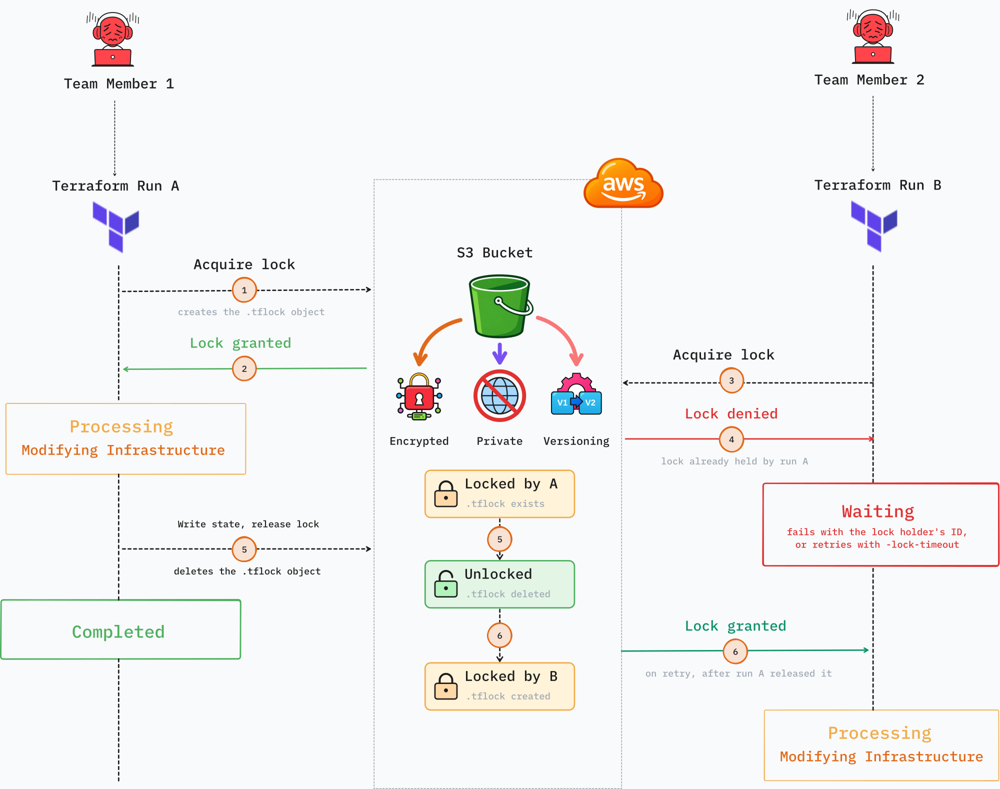

# 🗄️ STATE FILE REMOTE BACKEND

State File Remote Backend project creates an AWS S3 bucket that lets you store terraform state data remotely. Storing Terraform state files remotely gives you a single source of truth between your local machine, your teammates and your pipelines, along with state versioning, locking, server-side encryption and blocking public access.

[](https://developer.hashicorp.com/terraform/install)
[](https://aws.amazon.com/)

## 🏗️ Architecture Overview



When a team member or a CI/CD pipeline applies changes, the state acquires a lock for the duration of the apply. This prevent other team members or pipelines from modifying the state in the middle of an operation. If the state is already locked, Terraform refuses to proceed and reports who holds the lock and when it was acquired. Only one operation can hold the lock at a time, and the lock is released when the operation completes.

## 📦 What gets Created
 
| Resource | Purpose |
| --- | --- |
| S3 bucket | Stores Terraform state files |
| Bucket versioning | Keeps every version of the state so you can roll back |
| Server-side encryption | Encrypts state at rest using the KMS key |
| Public access block | Guarantees the bucket can never be made public |
| KMS key | Customer managed key (CMK) used to encrypt the state |
| KMS alias | Friendly name (`alias/<name>`) for the key |
 
The S3 bucket and KMS key are protected with `lifecycle { prevent_destroy = true }`, because losing either one means losing your state.

## 🚀 Getting Started

### 🧰 Prerequisites

**Install the following on your local machine before creating remote Backend:**

- [Terraform](https://developer.hashicorp.com/terraform/install) >= 1.10
- [AWS CLI](https://docs.aws.amazon.com/cli/latest/userguide/getting-started-install.html) >= 2.x, configured with credentials (`aws configure`)

Your AWS credentials need permission to create S3 buckets, KMS keys and IAM roles/policies.

### 🛠️ Installation

1. Clone the repo, change directory and create a  `terraform.tfvars` file in the project root:

    ```bash
    git clone https://github.com/mohitd-13/state-file-remote-backend.git
    cd state-file-remote-backend
    touch terraform.tfvars
    ```
    
2. Open `terraform.tfvars` in your code editor and populate the following variables:

    ```hcl
    aws_region        = "<Name of the aws region where you want to create the remote backend>"
    state_bucket_name = "<Write a unique name for the S3 bucket>"
    ```

> [!NOTE]
> S3 bucket names are globally unique, so choose something specific to you or your organisation.
> `terraform.tfvars` is listed in `.gitignore` and must never be committed.

3. Initialize Terraform, validate and view the resources that will be created:

    ```bash
    terraform init
    terraform validate
    terraform plan
    ```

4. Apply Terraform configurations:

    ```bash
    terraform apply -auto-approve
    ```

### 📋 Inputs

| Variable | Description | Required |
| --- | --- | --- |
| `aws_region` | AWS region where the backend is created | Yes |
| `state_bucket_name` | Globally unique name for the S3 state bucket | Yes |
| `kms_deletion_window` | Number of days after a kms key will be deleted | No |
| `tags` | Common tags apply to all resources | No |

### 📤 Outputs

After `terraform apply`, use the values below to configure your other projects and pipelines. Replace this section with your actual output names.

| Output | Description |
| --- | --- |
| `state_bucket_name` | Name of the S3 bucket to reference in `backend` blocks |
| `state_bucket_arn` | ARN of the S3 bucket that store state files |
| `kms_key_alias` | Alias of the KMS key to reference in `backend` block |
| `kms_key_arn` | ARN of the KMS key that encrypt the state |

# 📚 Why and How to Use the Backend

Learn why a remote backend is worth having, and how to connect your other Terraform projects to it, in [BACKEND.md](./docs/BACKEND.md).

## 💣 Destroying the Backend

Because of `prevent_destroy`, `terraform destroy` will fail on the bucket and KMS key by design. To tear the backend down on purpose:

1. Migrate every project using this backend back to local state (`terraform init -migrate-state`).
2. Empty the bucket, including all object versions.
3. Remove the `prevent_destroy` setting and apply the change.
4. Run `terraform destroy`. Note that KMS keys are scheduled for deletion after a waiting period (10 days) rather than removed immediately.

## 🔄 Continuous Integration

This project doesn't need continuous deployment, so the CI workflow only validates the code. Every time changes are pushed, it runs format checks, lints the code with [tflint](https://github.com/terraform-linters/tflint), and scans it with [Checkov](https://www.checkov.io/). The scan results are uploaded to GitHub code scanning. The workflow lives in `.github/workflows/`.

## 🤝 Contribution

Once the backend is deployed it rarely needs changes, so pull requests are not expected. If you find a bug or have an idea, please [open an issue](https://github.com/mohitd-13/state-file-remote-backend/issues).

## 📄 License

This project is licensed under the [MIT License](LICENSE).
